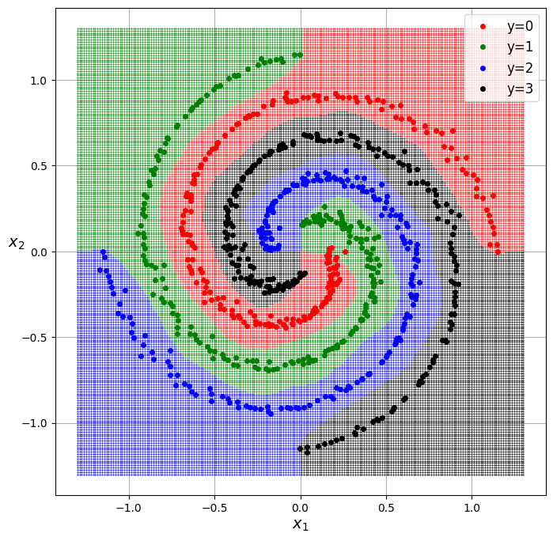
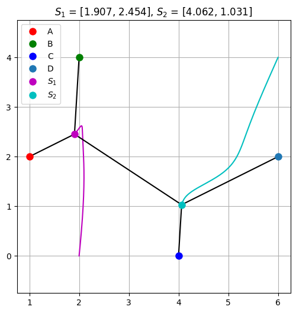

# Exercices de Machine Learning

On y part de la régression linéaire codée à la main et on va jusqu'au transfer learning avec VGG16.


<p align="center">
  
  
</p>

## Notebooks

| # | Notebook | Contenu | Colab |
|---|---|---|---|
| 1 | [Régression linéaire](01_linear_regression.ipynb) | Régression linéaire, normalisation, descente de gradient codée à la main | [](https://colab.research.google.com/github/Anatole-1/exercices-machine-learning/blob/main/01_linear_regression.ipynb) |
| 2 | [Régression logistique](02_logistic_regression.ipynb) | Classification binaire et multi-classes, frontières de décision non linéaires | [](https://colab.research.google.com/github/Anatole-1/exercices-machine-learning/blob/main/02_logistic_regression.ipynb) |
| 3 | [Réseaux convolutifs](03_convolutional_neural_networks.ipynb) | CNN sur images, data augmentation, transfer learning (VGG16) | [](https://colab.research.google.com/github/Anatole-1/exercices-machine-learning/blob/main/03_convolutional_neural_networks.ipynb) |
| 4 | [Réseaux de neurones](04_neural_networks.ipynb) | Réseaux denses : classification et régression sur données tabulaires | [](https://colab.research.google.com/github/Anatole-1/exercices-machine-learning/blob/main/04_neural_networks.ipynb) |

## Résultats

| Exercice | Jeu de données | Méthode | Résultat |
|---|---|---|---|
| 1.1 | Combined Cycle Power Plant | Régression linéaire | MAE = 3.63 MW |
| 1.4 | 4 points fixes | Descente de gradient (points de Steiner) | Longueur totale = 8.345 |
| 2.1 | Breast Cancer Wisconsin | Régression logistique | 562 / 569 bien classés |
| 2.2 | Wine recognition | Régression logistique (3 classes) | 178 / 178 bien classés |
| 3.1 | Sign Language MNIST (24 lettres) | CNN | accuracy = 98.6 % |
| 3.2 | Sign Language Digits (10 chiffres) | CNN | accuracy = 99.3 % |
| 3.3 | Flowers (5 classes) | CNN + data augmentation | accuracy = 93.8 % |
| 3.4 | Flowers (5 classes) | Transfer learning VGG16 | accuracy = 92.3 % |
| 4.1 | 4 spirales | Réseau dense, 1 couche cachée | accuracy = 98.8 % |
| 4.2 | Apple Quality | Réseau dense (binaire) | accuracy = 89.7 % |
| 4.3 | Dry Beans (7 classes) | Réseau dense | accuracy = 93.7 % |
| 4.4 | Sign Language MNIST | Réseau dense | accuracy = 82.6 % |
| 4.5 | Car Features and MSRP | Réseau dense (régression) | MAE = 2 611 $ |

## Lancer les notebooks

### En local

```bash
git clone https://github.com/Anatole-1/exercices-machine-learning.git
cd exercices-machine-learning
pip install -r requirements.txt
jupyter notebook
```

### Dans Google Colab

Il suffit de cliquer sur le badge *Open in Colab* du notebook voulu. La première cellule de code clone le dépôt pour récupérer les données.

> Sans GPU, les entraînements des réseaux convolutifs (notebook 3) prennent du temps. Dans Colab : *Runtime → Change runtime type → GPU*.

## Structure

```
.
├── 01_linear_regression.ipynb
├── 02_logistic_regression.ipynb
├── 03_convolutional_neural_networks.ipynb
├── 04_neural_networks.ipynb
├── data/              # jeux de données utilisés par les notebooks
├── images/            # figures des énoncés
└── requirements.txt
```

## Données

| Fichier | Notebook | Source |
|---|---|---|
| `data/Folds5x2_pp.csv` | 1 | [Combined Cycle Power Plant – UCI](https://archive.ics.uci.edu/dataset/294/combined+cycle+power+plant) |
| `data/data_ex3.txt` | 1 | Relevé sur les courbes de pompe de l'énoncé (voir ci-dessous) |
| `data/sign_mnist.zip` | 3, 4 | [Sign Language MNIST – Kaggle](https://www.kaggle.com/datasets/datamunge/sign-language-mnist) (extrait automatiquement) |
| `data/apple_quality.csv` | 4 | [Apple Quality – Kaggle](https://www.kaggle.com/datasets/nelgiriyewithana/apple-quality) |
| `data/Dry_Bean_Dataset.csv` | 4 | [Dry Bean – UCI](https://archive.ics.uci.edu/dataset/602/dry+bean+dataset) |
| `data/ex5_data.csv` | 4 | [Car Features and MSRP – Kaggle](https://www.kaggle.com/datasets/CooperUnion/cardataset) |

Téléchargés automatiquement à l'exécution : Breast Cancer et Wine (`sklearn.datasets`), [Sign Language Digits](https://github.com/ardamavi/Sign-Language-Digits-Dataset), Flowers et les poids VGG16 (Keras).

`data/data_ex3.txt` est un relevé des courbes Q–H de l'énoncé : 7 vitesses de 900 à 1 480 tr/min, débit par pas de 50 m³/h. Les sorties enregistrées dans le notebook viennent du relevé d'origine. En relançant avec ce fichier, on obtient des coefficients proches, mais pas identiques (par exemple w₁ = 18.26 au lieu de 17.84).
